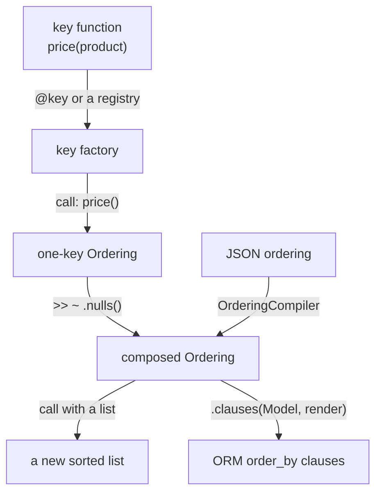

# User guide

pyordering has a handful of pieces. Each page covers one of them with examples you can
paste and run (every `python` block in these docs is executed by the test suite).

| Piece | What it is | Page |
| --- | --- | --- |
| `key`, `Ordering` | key factories, and the orderings they compose into with `>>`, `~` and `nulls()` | [Keys and orderings](orderings.md) |
| `OrderingRegistry` | the named keys a JSON ordering may use, and nothing else | [Registries](registries.md) |
| `OrderingCompiler` | JSON orderings to `Ordering` values, with errors that point at the JSON path | [Compiling orderings from JSON](compiling.md) |
| `get_ordering_json_schema` | JSON Schema of the orderings a compiler accepts | [JSON Schema](json-schema.md) |
| `Ordering.clauses` | `order_by` clauses for SQLAlchemy, Django or MySQL | [SQLAlchemy and Django](orms.md) |

## The mental model

1. You write small **key functions** that take the subject and return what to sort by.
2. `@key` (or a registry) turns each into a **key factory**. Calling the factory binds its
   arguments and returns a one-key **ordering**.
3. Orderings **compose**: `>>` adds tie-breakers, `~` flips every direction, `nulls()` says
   where `None` goes. Nothing is sorted yet.
4. Calling an ordering with an iterable **sorts** it into a new list. Calling `clauses()` with
   a model class turns it into ORM `order_by` clauses instead.

An ordering is immutable: every operator returns a new ordering, so a base ordering can be
shared and extended safely.
